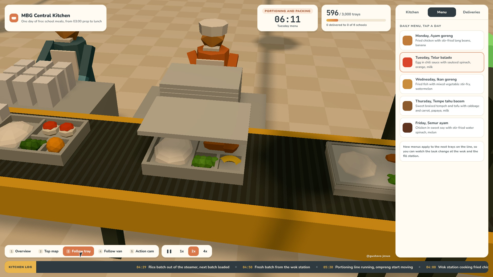

# MBG Kitchen

A small browser 3D simulation of one day inside an Indonesian MBG (Makan Bergizi Gratis) central kitchen, the kind of SPPG kitchen that cooks free school meals before dawn and gets them to classrooms before lunch.

You do not play it, you watch it run and direct the view. Ingredients arrive, produce gets washed and cut, rice steams, the wok line cooks the lauk, stainless ompreng trays roll down the portioning line and get rice, protein, vegetables and fruit, then a lid, a QC check, crates, and box vans that drive out to six schools and come back.

**Live demo** https://gustavojesuss69.github.io/mbg-kitchen/



## What you can do

- **Camera modes** Overview (drag to orbit), Top map, Follow tray, Follow van, Action cam. Keys `1` to `5`.
- **Time** pause, 1x, 2x, 4x. `Space` toggles pause. At 1x one real second is one kitchen minute, the day runs from 03:00 to late morning.
- **Kitchen tab** live status of every station and what goes on each tray today (carbs, protein, vegetables, fruit).
- **Menu tab** switch the daily menu (ayam goreng, telur balado, ikan goreng, tempe tahu bacem, semur ayam). New trays on the line pick up the change.
- **Deliveries tab** schools served, ETA per school and where each van is.
- **Kitchen log** a running ticker of what happens, plus floating popups for crates, vans and deliveries.

## Notes

- Everything is a stylized simulation. Schools, tray counts, timings and menus are sample data for the sim, not official program figures.
- Workers are generic low-poly figures, no real people are depicted, and there are no official logos.

## Run locally

```bash
npm install
npm run dev     # http://localhost:5173
npm run build   # static site in dist/
```

Built with [Three.js](https://threejs.org) and [Vite](https://vitejs.dev). Deployed to GitHub Pages with GitHub Actions on every push to `main`.

## License

MIT, see [LICENSE](LICENSE).

Made by @gustavo jesus
